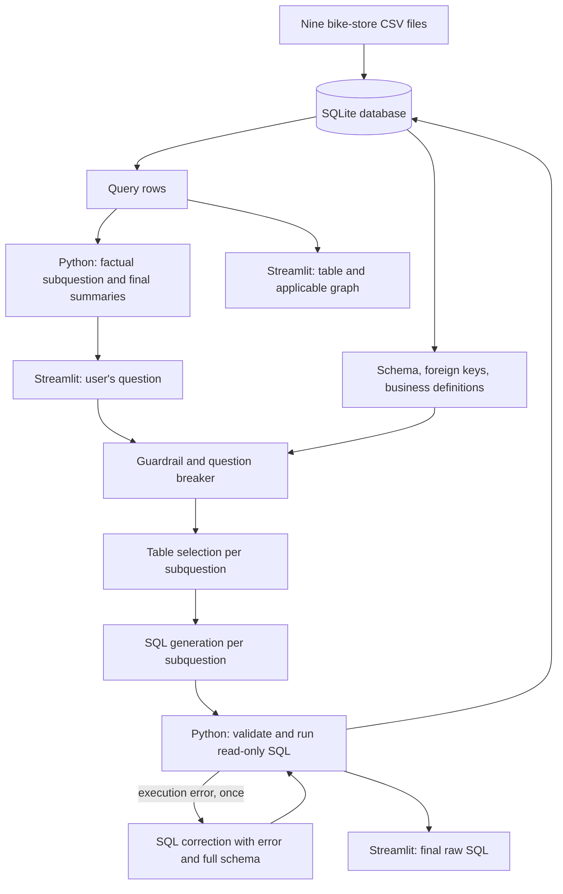

# Text-to-SQL Chatbot for Bike Store

## Architecture and tech stack

Python 3.9+, Streamlit 1.50, pandas, SQLite, and the Gemini generateContent REST API. The default model is **gemini-3.8-flash**; **gemini-3.5-flash-lite** is also supported. Gemini structured output returns SQL and chart metadata in a defined JSON shape. [Model documentation](https://ai.google.dev/gemini-api/docs/models), [structured output](https://ai.google.dev/gemini-api/docs/generate-content/structured-output). The original assignment requested `gpt-4o-mini`; this implementation uses Gemini at the user's request.

## Agent definition and prompt

The workflow has separate prompt-driven guardrail/question-breaker, table-selection, SQL-generation, and SQL-correction stages. The breaker handles up to three self-contained subquestions. Python executes the final SQL, summarizes actual rows, renders the plan's chart when applicable, combines subanswers, and suggests existing example questions. These are callable agents, without a multi-agent framework or vector database.

Full prompt: `bikestore/llm.py`, `generate_plan`. Dataset-specific rules: `bikestore/assignment.py`, `BUSINESS_RULES`. Main instruction:

> Generate one SQLite SELECT using only the supplied tables and columns. Preserve every requested filter. Use foreign keys to form joins. Ask for clarification when required information is unavailable. Never change data or invent business facts.

Assignment conventions:

- Revenue is `SUM(quantity * order_items.list_price * (1 - discount))`.
- Include all order statuses unless asked otherwise, matching the supplied reference SQL.
- Interpret “best selling” as revenue unless units are explicitly requested.
- “Products from California” filters `customers.state = 'CA'`, following the supplied example. Explicit store-location questions use `stores.state`.
- Employee table: **staffs**. Status codes: 1 pending, 2 processing, 3 rejected, 4 completed.
- Real data spans 2016-01-01 through 2018-12-28. No synthetic data is mixed in.

## Validation and error handling

1. Validate the question and API configuration.
2. Validate the model's structured plan; handle refusals, incomplete responses, clarifications, and provider errors.
3. Allow one SELECT/nonrecursive CTE. Use SQLite read-only mode, allowed tables/functions, row limits, and a two-second execution limit. Deny writes, metadata access, extensions, and multiple statements.
4. On an execution error, send the SQL, error, and full schema to the corrector once; validate and run the corrected SQL through the same read-only executor. Report a repeated failure.
5. Evaluate semantically wrong joins against ground truth. Syntax checks alone cannot establish that a join answers the user's question.

The correction loop is bounded to one retry per subquestion. The UI shows when correction occurred.

## Evaluation method and metrics

`evaluate.py` executes ground-truth SQL and generated SQL against the same database. Only the question and schema are sent to the model; expected SQL and answers are withheld.

| Metric | Definition |
| --- | --- |
| Execution accuracy | Complete generated results matching reference results / all cases |
| SQL execution success | Generated queries that execute successfully / all cases |
| Average response time | Mean generation + validation + execution + answer-formatting time, including failed attempts |
| P95 response time | Nearest-rank 95th percentile |
| Under-60-second rate | Attempts finishing below 60 seconds / all attempts; inspect alongside success rate |
| Cost | Returned input/output token usage multiplied by standard rates |

Comparison preserves duplicates and ignores aliases, but requires the same column order. Row order is checked when `order_sensitive` is true, for example in sorted top-N results. Integers match exactly; decimal absolute tolerance is $0.01. Nulls and strings must match. Truncated results cannot pass. If supplied expected rows disagree with reference SQL on this database, the report identifies a ground-truth/data error.

Result matching is preferable to exact SQL-text matching because equivalent SQL can be written differently. Answers are deterministic descriptions of the result; no separate semantic answer-similarity score is claimed. Human review can assess completeness and readability.

## Verified supplied examples

`validation/examples.json` contains the three questions, reference SQL, and expected answers from the statement. `validation/example_results.json` contains executed outputs.

| Question | Verified result |
| --- | --- |
| How many stores do we have? | 3 |
| List all brand names in our catalog. | Electra, Haro, Heller, Pure Cycles, Ritchey, Strider, Sun Bicycles, Surly, Trek |
| Top 3 products from California | Trek Slash 8 27.5 - 2016: 32 units, $115,119.7122; Trek Conduit+ - 2016: 39 units, $103,199.6560; Trek Fuel EX 8 29 - 2016: 31 units, $81,286.7197 |

**3/3 reference examples match.** This verifies data and execution, not LLM accuracy. No paid model calls were made. UC10 and its ground-truth files were not supplied, so **UC10 accuracy and average LLM response time remain unmeasured**. Run evaluation once those files and an API key are available.

## Cost estimate: 100 user queries

Assume three calls for a simple question (breaker, table selection, SQL generation), 2,000 input tokens and 300 output tokens per call, and no cached-input discount:

- Input: `100 × 3 × 2,000 × $0.75 / 1,000,000 = $0.450`.
- Output: `100 × 3 × 300 × $3.75 / 1,000,000 = $0.3375`.
- **Estimated paid-tier total: $0.7875.** Free-tier eligible calls cost $0. Multiple subquestions and correction retries add calls. Actual usage varies with the schema, question, history, and response length.

Rates checked on 2026-10-08 against [Gemini pricing](https://ai.google.dev/gemini-api/docs/pricing). The UI and evaluator report successful-call token usage. Failed calls may also be billed. Monitor account usage to stay within the $2 experiment budget; the UI's session estimate is not an account-wide spending cap.

## Source and deployment

For Streamlit hosting, use `streamlit_app.py` as the entry point, install `requirements.txt`, and configure `GEMINI_API_KEY` through secrets. Live model quality and latency remain unmeasured without an API key.
